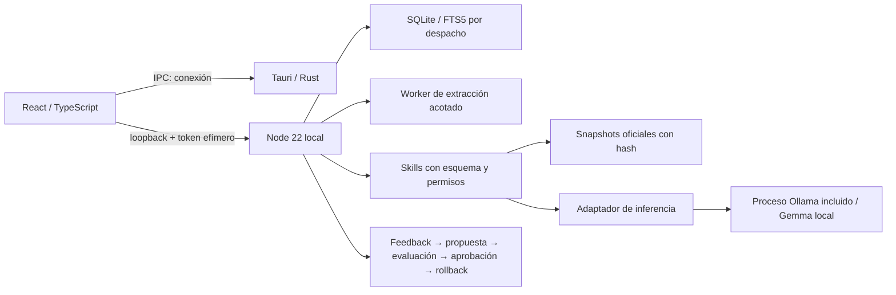

# Arquitectura

## Seis capas
1. Desktop: navegación, asuntos, documentos, investigación, skills, conocimiento y configuración. Tauri no concede shell ni acceso general al filesystem al webview.
2. Inferencia: interfaz `status/initialize/generate/stop`; proceso separado, loopback, modelo fijado por digest, verificación de archivos, salida estructurada y tiempo límite. La descarga usa la red; prompts/documentos no.
3. Conocimiento legal: seis artículos de contratos de dos códigos oficiales con PDF original, hash, versión, jurisdicción y estatus temporal no verificado. No son cobertura de jurisprudencia.
4. Conocimiento privado: SQLite con archivos originales como blobs, texto y FTS por asunto; un directorio privado por despacho. No backend SaaS. No embeddings todavía.
5. Skills: cinco definiciones universales versionadas; la primera validación real se centra en revisión contractual. Sin ejecución arbitraria de herramientas ni interpretación de documentos como instrucciones.
6. Aprendizaje en la aplicación: notas del asunto derivadas de feedback, evaluación estructural, aprobación explícita y rollback transaccional. No entrenamiento ni activación automática. Por autorización posterior del dueño existe un pipeline de desarrollo separado: QLoRA local MLX con legislación pública, particiones por ley, evaluación emparejada y exportación experimental; ver `../training-runbook.md`.

## Límites de confianza
El servidor crea su token, Tauri lo recibe por stdout y lo entrega mediante IPC; no se guarda en argumentos del proceso ni disco. En desarrollo el enlace con fragmento es temporal y no debe compartirse. El origen web se comprueba y la API requiere autenticación. El token no protege ante malware con los mismos privilegios del usuario; SQLite y los modelos no están cifrados por esta aplicación.

La inferencia transmite tokens internamente; la interfaz solo recibe el texto después de validar la estructura y citas. Esto evita exhibir texto fallido como análisis aprobado, a costa de perder la animación de tokens en tiempo real. La correspondencia de citas no prueba la conclusión jurídica.

## Evolución
Añadir embeddings locales e índice híbrido detrás de la recuperación, packs de práctica como datos versionados, proveedores de jurisdicción, roles/ACL antes de compartir una instalación y servidor dedicado por despacho. La licencia comercial futura no puede bloquear exportaciones del propietario. No conectar facturación con documentos o inferencia.
