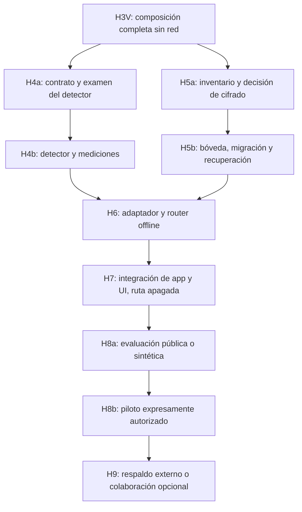

# Plan SF para completar la transición híbrida

Fecha: 2026-11-09. Coordinador: Codex, sesión actual `gpt-6.1-sol`. Dirección del dueño: plan con los colaboradores de la SF, **sin Claude por el momento**. Astra queda reservado para código crítico cuya dificultad justifique su intervención. Este documento planifica trabajo; no inicia implementación, entrenamiento ni un servicio desatendido.

## Punto de partida y resultado esperado

H1, H2 y H3 están terminadas en el [PR #1](https://github.com/santirosado21-spec/lex-ai/pull/1), hacia `rescate-0.4.13`: mock con captura completa, puerta de salida y correspondencias reversibles sintéticas en memoria. Última verificación de código registrada: 467/467 pruebas y build correcto. No se repitió esa suite para redactar este plan.

Resultado: una aplicación LEX AI que conserva conversaciones, biblioteca oficial, documentos/escritos, expedientes, búsqueda y horas; usa un detector pequeño local para preparar contexto y puede enviar únicamente contexto permitido a una ruta remota explícita por tarea. Originales, historial privado y correspondencias permanecen locales. Seudonimización reversible no garantiza anonimización. Meta de hardware: 8 GB, pendiente de medición física.

La base actual sigue usando `createInference` en `server/main.mjs`; hay llamadas a generación en `server/conversation.mjs`, `server/service.mjs` y `server/proactive-drafts.mjs`. `server/store.mjs` usa `node:sqlite`, FTS y `journal_mode=DELETE`; permisos no equivalen a cifrado. El inventario cubrirá WAL/SHM cuando sean aplicables, sin cambiar el modo de journal por suposición.

## Secuencia y entregas

Antes de cerrar H4b, H5a debe haber congelado el inventario y los contratos de serialización/procedencia. Si H5b cambia esos contratos, se repiten las mediciones afectadas del conjunto antes de H6; no se invalida por ello todo el trabajo de reglas/dataset.

H4a/H4b y H5a/H5b son subentregas de los frentes existentes, no estados `done` nuevos por redactar documentos. H4 o H5 se cierran solo al completar su aceptación. Se puede preparar el contrato de H6 antes; su cierre e integración conservan las dependencias H4/H5 del backlog. El trabajo paralelo exige responsables y worktrees distintos; las ejecuciones que compiten por memoria se miden primero separadas y después juntas.

### H3V — Primer recorrido completo simulado

**Propietario previsto:** Codex/Sol. Revisión: Cursor/Grok si el acceso/modelo se verifica, o un revisor Sol separado. No requiere Astra de entrada.

**Archivos:** crear `tests/hybrid-offline-flow.test.mjs`, `tests/fixtures/hybrid/synthetic.mjs` y `docs/qa/hybrid-H3V-2026-11-09.md`. Solo ajustar `server/egress-policy.mjs`, `server/privacy/pseudonyms.mjs` o `server/inference-mock.mjs` si la composición demuestra un defecto; registrar antes el cambio de alcance.

**Trabajo y aceptación:**

1. Recuperar exclusivamente fragmentos sintéticos del despacho/asunto/hilo solicitado, proteger entidades declaradas, clasificar el sobre completo, pasar por H2, capturar el mock, validar y restituir. El siguiente turno vuelve a proteger la respuesta restituida. Comparar el JSON y los bytes reales del mock con la instantánea clasificada.
2. Cubrir dos despachos, dos asuntos, hilos distintos, historial, nombres de archivos/metadatos, fuentes y esquema. Procedencia y mapas permanecen fuera del payload; ninguna identidad declarada prohibida aparece en la captura. Esto prueba fixtures, no calidad del detector.
3. Definir desde aquí el contrato de chats generales/legacy: los registros sin asunto o hilo siguen disponibles localmente; no obtienen un ámbito remoto compartido ni comodín. El primer flujo híbrido exige asunto e hilo explícitos. H7 implementará una asociación/migración local explícita con nueva evaluación, sin reinterpretar los registros antiguos como públicos. Probar el bloqueo de los casos sin ámbito.
4. Probar mutaciones/versiones entre cada fase, cambio de política, cancelación, excepción del clasificador, respuesta inválida y fallo del proveedor. Nunca retry/fallback. Bytes ya enviados no se pueden retirar al cancelar.
5. Fijar un escritor por asunto durante protección/generación/restitución. Con el contrato H3 actual, otra alta que cambie la versión activa debe esperar o invalidar la operación; se comprueba la versión antes de mostrar/guardar texto. Snapshots antiguos no sobrescriben un asunto activo. Probar dos operaciones que se intercalan y el fallo de snapshot antiguo ya corregido.

**Cierre:** prueba vertical conservada junto a las unitarias; suite/build y revisión independiente. No conectar todavía el motor de producción ni llamar a una red real.

### H4a — Protocolo del detector y procedencia

**Propietario previsto:** Codex/Sol. Gemma clasifica etiquetas o extrae campos de fixtures públicos/sintéticos; Groq prepara borradores de casos. Codex contrasta ambos con la fuente. Gemini/Kimi cuestionan el protocolo; no conceden permisos ni validan legalmente el producto.

**Archivos:** crear `docs/architecture/privacy-classification-v1.md`, `eval/privacy/README.md`, `eval/privacy/dev.jsonl`, `eval/privacy/heldout.jsonl`, `eval/privacy/manifest.json`, `scripts/eval-privacy.mjs`; preparar `tests/privacy-detector.test.mjs` y `tests/privacy-provenance.test.mjs`.

**Aceptación:** protocolo congelado antes del examen: categorías, unidad de conteo, casos ambiguos, relaciones y hechos reidentificables, formato soportado, criterios de bloqueo, semillas, hashes y separación desarrollo/examen. El heldout no se entrega a generadores ni se usa para afinar. Si se consulta para corregir, se retira ese conjunto como examen final y se documenta una nueva versión independiente.

El contrato de clasificación tiene dos comprobaciones distintas: pertenencia verificable al ámbito y tratamiento del contenido. El detector no decide permisos. La procedencia se registra al importar/crear datos, se comprueba al recuperarlos y los derivados heredan la categoría más restrictiva: historial, resúmenes, fragmentos FTS, resultados de herramientas y borradores. El texto de un documento no puede autoclasificarse. Datos sin procedencia fiable bloquean salida. La evidencia jurídica conserva URL oficial recuperable, jurisdicción, artículo/identificador, fecha/versión y fragmento; un enlace por sí solo no valida una afirmación.

**Medición base temprana:** H4a y H5a registran el consumo del runtime empaquetado, UI, índice y una carga representativa antes de elegir detector/cifrado. El protocolo fija un límite cuantitativo de memoria/latencia y una regla de parada antes de observar el heldout. No se adopta el ejemplo de 400 MB de un revisor como requisito medido.

**Umbrales:** cero omisiones en los casos obligatorios de identificadores estructurados y cero cruces de ámbito del corpus congelado; toda incertidumbre o formato no soportado bloquea. Informar precisión/recobrado y omisiones por categoría, reidentificación contextual y preservación de fechas/importes/citas. Los límites de falsos positivos y utilidad se fijan por categoría en este protocolo antes del heldout; si no se fijan, H4a permanece pendiente. Cero fallos observados en ese corpus no demuestra riesgo cero fuera de él.

### H4b — Detector real pequeño y examen

**Archivos:** crear `server/privacy/detector.mjs`, `server/privacy/provenance.mjs`, `tests/privacy-detector.test.mjs`, `tests/privacy-provenance.test.mjs` y reporte versionado en `docs/qa/`. Cambiar `resources/model-catalog.json` solo si se elige un candidato local medido con digest/licencia y autorización de descarga aplicable.

**Trabajo:** reglas locales para identificadores y un detector pequeño para entidades/contexto, con rangos validados contra el texto original. Medir primero reglas solas y después reglas+modelo; elegir por evidencia. No reutilizar el conversacional como detector validado ni descargar/cargar automáticamente modelos grandes. Tratar Unicode, formatos escaneados y extracción parcial explícitamente; bloquear los formatos sin tratamiento fiable.

**Cierre:** omisiones y falsos positivos por categoría; ejemplos fallidos conservados; latencia p50/p95, memoria del proceso detector y del conjunto app+SQLite+detector, versiones y hardware real. Medir arranque frío/caliente y documentos de tamaños fijados por el protocolo. Determinar el presupuesto de memoria a partir de la base y reservar margen al sistema; no inventar garantías de 150 ms o 1 GB. La medición en esta Mac de 24 GB se etiqueta como tal. Sin equipo físico de 8 GB, no se cierra la validación de ese requisito aunque el componente funcional pueda pasar. Reejecutar H3V con el detector real sobre fixtures retenidos de integración.

### H5a — Cifrado y recuperación: decisión verificable

**Propietario:** Codex. Kimi revisa fallos de migración y recuperación. Astra se considera únicamente al implementar el límite criptográfico/integración nativa, sin asignarle este documento.

**Archivos:** crear `docs/architecture/adr/0002-private-vault.md`, `docs/architecture/private-data-inventory.md`, `docs/qa/vault-test-protocol.md`. Inspeccionar `server/store.mjs`, `server/extraction.mjs`, `server/extraction-worker.mjs`, `server/docx-export.mjs`, `server/stt.mjs`, `server/office-bridge.mjs`, `server/local-email.mjs`, `server/main.mjs`, `server/service.mjs`, módulos de exportación/dictado/Office/correo y `src-tauri/src/`; resolver nombres reales con `rg` y fijar la lista definitiva antes de asignar código.

**Decisión:** comparar una compilación SQLCipher mantenida compatible con el runtime empaquetado y una alternativa mantenida de almacén/índice cifrado. SQLCipher es candidato, no dependencia elegida. No basta ejecutar `PRAGMA key` sobre `node:sqlite` normal ni cargar SQLCipher como extensión: requiere su propia compilación [diseño oficial](https://www.zetetic.net/sqlcipher/design/). Verificar licencia, mantenimiento, FTS, ABI Node/Rust, Apple Silicon y empaquetado, sin comprar ediciones comerciales.

Inventariar originales, tablas/FTS, correspondencias, índices/diarios, nombres de archivo, caches, temporales, logs, crash dumps, exportaciones y copias. Separar archivos de biblioteca pública de material privado. Las exportaciones pedidas por el usuario son una salida explícita; los temporales de la aplicación no deben quedar en claro al bloquear. Definir amenaza y límites: cifrado en reposo no protege frente a un proceso autorizado con la bóveda abierta ni garantiza borrar copias históricas del SSD.

**Cierre:** ADR con solución, contrato y archivos/bibliotecas exactos; llave de datos por ámbito de bóveda con aislamiento de acceso; custodia local mediante APIs mantenidas del sistema y mecanismo recuperable fuera del equipo perdido. Elegir recuperación, rotación/revocación y procedimiento de pérdida antes del código. Keychain no cuenta por sí solo como prueba de recuperación en otro entorno; estudiar [APIs Keychain de Apple](https://developer.apple.com/documentation/technotes/tn3137-on-mac-keychains).

### H5b — Bóveda, migración y restauración

**Archivos previstos, sujetos al ADR:** `server/store.mjs`, `server/privacy/vault.mjs`, `server/privacy/key-store.mjs`, `server/privacy/migration.mjs`, `server/main.mjs`, `src-tauri/src/vault.rs`, `src-tauri/src/main.rs`, `src-tauri/Cargo.toml`, `package.json` y lockfiles solo si la solución los necesita; `tests/privacy-vault.test.mjs`, `tests/privacy-recovery.test.mjs`, `tests/privacy-migration.test.mjs`, `scripts/qa-vault-artifacts.mjs`; QA versionada. Incorporar los módulos privados adicionales que revele H5a antes de asignar archivos.

**Aceptación:** pruebas desde una COPIA sintética, migración transaccional/reanudable y manifiesto consistente de base, originales y versiones de mapa; fallo por corte de proceso, disco lleno, clave incorrecta, backup truncado/corrupto y restauración parcial; no reapertura silenciosa de base sin cifrar. Una restauración exige versión/ámbito esperados y una política explícita sobre escrituras posteriores, nunca mezcla automática. Restablecer en perfil/entorno limpio sin depender del Keychain original y comprobar originales, mapas, chats, búsquedas y horas. Rotación y bloqueo cancelan operaciones y cierran accesos.

Examinar disco tras cierre/bloqueo/fallo y verificar la configuración real de temporales/diarios de la biblioteca elegida; un pase de búsqueda de canarios es solo una comprobación adicional. No migrar/borrar la base real de esta Mac. No prometer borrado completo de secretos en memoria JavaScript; minimizar su vida y documentar límites. Reejecutar H3V con almacén sintético cifrado y restauración comprobada. Revisión especializada del límite implementado antes de `done`.

### H6 — Adaptador y modelos por tarea, apagados

**Propietario previsto:** Codex/Sol o Cursor con modelo no-Claude verificado; revisión Sol separada. Astra solo si aparece un defecto de integración persistente.

**Archivos:** crear `server/providers/openrouter.mjs`, `server/providers/task-router.mjs`, `server/providers/usage-budget.mjs`, `tests/openrouter-provider.test.mjs`, `tests/task-router.test.mjs`, `tests/usage-budget.test.mjs`; documentar `docs/architecture/remote-provider-contract.md` y QA. Ninguna reutilización de `scripts/dsystem/remote.mjs`, sus credenciales o sus declaraciones Free para el producto.

**Aceptación offline:** `enabled:false` por defecto, transporte HTTP inyectado; proveedor/modelo/endpoint exactos y versionados, cabeceras mínimas y sin originales/herramientas. Capturar bytes del cuerpo FINAL serializado y demostrar que esa misma representación fue revisada/autorizada: serializar después no puede añadir nombres, instrucciones, metadata o esquemas sin nueva comprobación. Capturar también destino/cabeceras con secretos sustituidos por fixtures.

Usar lista cerrada de endpoints, `allow_fallbacks:false`, parámetros requeridos y política de datos comprobada; confirmar el significado actual de `only`, `data_collection` y `zdr` en la [documentación oficial de routing](https://openrouter.ai/docs/guides/routing/provider-selection). Verificar por separado [retención de proveedores](https://openrouter.ai/docs/guides/privacy/provider-logging) y tratamiento del agregador. No interpretar esos flags como auditoría o autorización de clientes.

El presupuesto total tiene moneda/unidad, ámbito por tarea/despacho, tarifa versionada, tokens de entrada/salida/razonamiento aplicables, máximo de salida y reserva atómica antes del envío. Reservar cargos posibles por cada intento, reconciliar uso informado y mantener reserva prudente si se desconoce el resultado; cancelar no equivale a coste cero. Tarifa por token no sustituye total. Sin reintentos automáticos ni fallback. Probar carrera por el último saldo, límite cero, tarifa ausente, 401/402/429, timeout y desconexión. Error de presupuesto tiene categoría propia, no un HTTP 401 inventado.

Dos perfiles candidatos: conversación/borrador y análisis jurídico complejo. Selección por tarea y política explícita, sin escalar basándose únicamente en confianza del modelo. Candidatos concretos, precios, versiones y endpoints se fijarán al preparar H8, no se declaran ganadores aquí. Reejecutar H3V con HTTP mock del adaptador final.

### H7 — Integración de producto y experiencia

**Archivos:** `server/main.mjs`, `server/service.mjs`, `server/conversation.mjs`, `server/proactive-drafts.mjs`, `server/skills.mjs`, `server/privacy/provenance.mjs`, `src/App.tsx`, `src/ChatSidebar.tsx`, `src/api.ts`; crear `src/PrivacySettings.tsx`, `tests/hybrid-routing.test.mjs`, `scripts/ui-hybrid-smoke.mjs`; extender `tests/general-conversation.test.mjs`, `tests/conversation-threads.test.mjs`, `tests/proactive-drafts.test.mjs`, `tests/service.test.mjs`, `tests/time-billing.test.mjs` y pruebas de exportación existentes según inventario. Fijar ownership exacto antes de editar.

Integrar primero un asunto nuevo, formato admitido y una generación con mock desde la app; ampliar después a conversación general, análisis, propuestas y cualquier otra llamada descubierta. H7 no será el primer contacto entre componentes: H3V ya lo compone y la regla legacy está fijada desde entonces. Mantener la ruta remota desactivada incluso con código integrado hasta su autorización correspondiente.

**Puerta de política privada:** H2 solo permite `public/synthetic`. Diseñar, probar y revisar una categoría explícita de contexto privado preparado con procedencia, tratamiento requerido y autorización delimitada/revocable del despacho. Nunca renombrar datos privados como sintéticos, eliminar `scopeVerified` ni aceptar la confianza del detector como permiso. Esa capacidad queda inactiva para clientes hasta H8b. Chats generales/legacy permanecen locales hasta tener asociación explícita; no usar un asunto artificial compartido ni un wildcard.

**Cierre:** matriz de todos los llamadores con ámbitos/permisos completos, bloqueo ante detector/almacén cerrado, versiones coherentes y ninguna salida alternativa. Ajustes muestran alcance/destino cuando ayuda a decidir, permiten modo solo local y revocación, y recuerdan autorizaciones válidas dentro de su alcance. No preguntar en cada turno por lo ya autorizado. El asistente se presenta como LEX AI, sin diagnósticos crudos. Archivos, biblioteca/búsqueda y horas siguen funcionando sin nube; conservar apertura de escritos y DOCX. Smoke UI y regresiones con synthetic mocks.

### H8a — Examen público/sintético y decisión de ruta

**Archivos:** `eval/hybrid/README.md`, `eval/hybrid/cases.jsonl`, `eval/hybrid/protocol.json`, `scripts/eval-hybrid.mjs`, reporte en `docs/qa/`. Preparación offline independiente de la disponibilidad de cuentas.

Registrar antes de evaluar: conjunto y hashes, dos rutas/modelos/endpoints concretos, orden aleatorio/ambos órdenes para juez, límites de gasto, tarifas/fecha y rubricado. Evaluar charla natural/multiturno/cambio de tema, instrucciones, resumen y borrador fieles, citas oficiales recuperables, jurisdicción/fechas, abstención y falta de hechos. Separar jueces automáticos de revisión profesional; un modelo maestro no es el único juez. Incluir omisiones de privacidad, fidelidad después de proteger/restaurar y regresiones de herramientas deterministas.

Medir coste total por respuesta aceptada, tokens facturados/caches/razonamiento cuando existan, latencia p50/p95 y fallos. Conservar casos fallidos y no entrenar con el examen. Un mock valida transporte, no calidad remota. Llamadas reales requieren acceso/product route autorizado y presupuesto explícito si hay cobro; cuenta de desarrollo PSF no se convierte en credencial comercial. Si esa puerta está pendiente, terminar el protocolo/runner offline y dejar la ejecución real pendiente con motivo, sin simular resultados.

### H8b — Piloto y salida evaluada

Piloto del despacho solo después de comprobar autorización específica para tratamiento/datos, condiciones efectivas de proveedor/agregador, cifrado/recuperación, aislamiento, revocación y gasto. Definir qué revisión del abogado exige cada salida y cómo volver a modo local. Empezar con alcance pequeño; cada ampliación necesita política/evidencia, sin cargas de clientes por inferencia de este plan.

Validar en equipo físico de 8 GB el flujo completo, tamaños de documentos y dataset fijados, memoria total, latencia y estabilidad. Si falta hardware, ese criterio sigue abierto. Firma/notarización, instalación limpia, actualización/reversión y condiciones de distribución son una puerta de lanzamiento comercial aparte; este plan no compra una membresía Apple ni atribuye validación profesional a tests técnicos.

### H9 — Extensiones posteriores

Backup cifrado a disco externo o Drive, restauración en otro entorno y custodia por el despacho. Colaboración multiusuario requiere servicio/autenticación/concurrencia propios; no abrir SQLite activa sincronizada entre computadoras. H9 no retrasa el primer recorrido público/sintético evaluado y no se declara hecho por existir un archivo de backup.

## Reparto SF y funcionamiento

| Asiento | Papel en las próximas entregas | Límites |
| --- | --- | --- |
| Codex/Sol | Coordina, implementa trabajo habitual, integra, prueba y decide | No se revisa a sí mismo como evidencia independiente |
| Gemini explícito | Objeciones al orden, experiencia y criterios | Modelo fijado en `agy --model gemini-3.8-flash-high` (o ID vigente verificado); no usar wrapper sin selección verificable; opinión textual, sin afirmar tests |
| Kimi | Contratos, fallos de recuperación, alternativas y orden | Una llamada a la vez; opiniones sin herramientas |
| Cursor/Grok | Revisión técnica o implementación acotada de archivos | Modelo no-Claude explícito y acceso/entorno comprobados antes de cada encargo; Auto excluido |
| Gemma local | Etiquetas, extracción de campos, resumen de logs públicos/sintéticos | No escribe código entregable ni decide seguridad/dinero |
| Groq | Borradores de casos/fixtures y listas de aceptación | Verificación del coordinador; no vota ni fija presupuestos/seguridad |
| OpenRouter :free, HF, Mistral | Opciones de apoyo si se verifican acceso y límites actuales | No habilitar credenciales, compras, recargas ni sustituciones para completar un panel |
| DeepSeek Harness/Copilot | Opcionales para una necesidad concreta futura | Verificar modelo, procedencia, cuota y permisos; no se asume participación por instalación |
| Astra | Código crítico de bóveda, aislamiento o defecto difícil | No documentación, síntesis, boilerplate o revisión rutinaria |
| Claude | Excluido temporalmente por orden actual | También excluido en Cursor/routers |

Un implementador y un revisor distintos por rebanada; cada encargo declara archivos, lectura de skills, datos públicos/sintéticos y aceptación. Los obreros no sustituyen una revisión independiente. Sin cuota/acceso no se compra ni repite en bucle: registrar, continuar lo independiente y dejar `review-pending` si falta revisión.

## Ejecución y cierre

Hay un [registro de aportaciones y límites del panel](hybrid-completion-review-2026-11-09.md); las opiniones se contrastaron con código y fuentes oficiales.

La siguiente sesión puede tomar H3V y después H4a **o** H5a según disponibilidad y medición de base, máximo dos subentregas. Esa sesión requiere un encargo de ejecución; este pedido es de planificación. El backlog principal conserva H3V/H4/H5/H6/H7/H8/H9 como `todo` hasta empezar realmente.

Por rebanada: declarar propietario/rama/archivos, implementar, pruebas dirigidas y negativas, `npm test`, `npm run build`, revisión independiente, corregir, guardar QA/estado y commit probado. Tres fallos de implementación sobre el mismo problema fuerzan diagnóstico antes de continuar. Publicar en la rama/PR de desarrollo acordados; no tocar `main`, fusionar ni desplegar por este plan. Actualizar `docs/agents/STATE.md`, `LOG.md` y decisiones reversibles.

Definición de terminado: comportamiento demostrado, evidencias reproducibles, revisión independiente y commit. Separar componentes offline completos, evaluación real pendiente, piloto autorizado y lanzamiento comercial. Un plan, catálogo o panel no valida privacidad ni producto.
