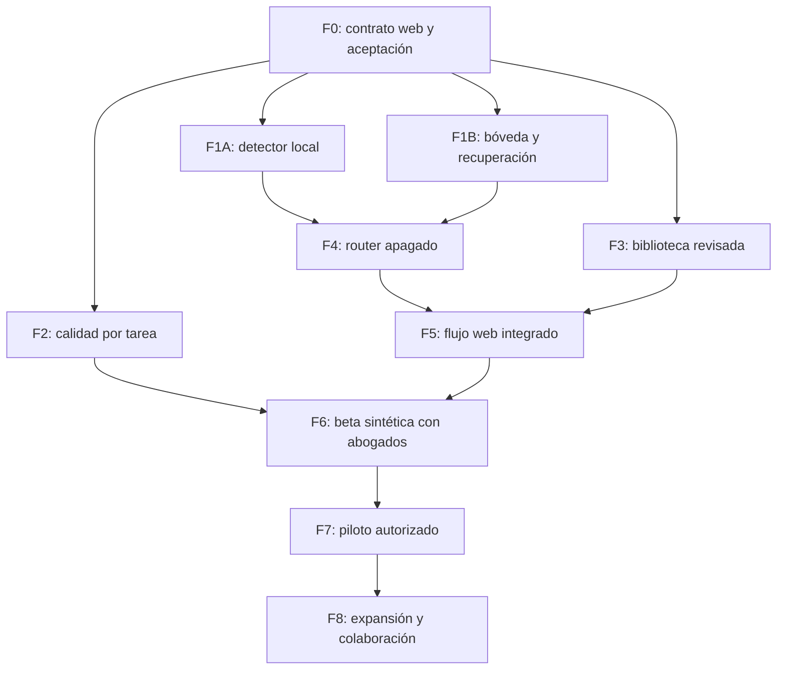

# Plan por fases hasta la beta y el piloto del despacho

Fecha local: 2026-11-09, America/Mexico_City. Coordinación: Codex. Este plan actualiza el orden de continuación después de S2a y de la aclaración de entrada confidencial; conserva los IDs y la evidencia del [backlog vigente](hybrid-development-backlog.md). No reabre entregas cerradas ni declara terminado un padre por completar un prototipo. Investigación del [nuevo nombre](../brand/naming-research-2026-11-09.md) en paralelo, sin renombrado todavía.

## Resultado y punto de partida

El usuario introduce el archivo original y su pregunta **en su equipo**. La extracción, detección, minimización y sustitución ocurren localmente antes de enviar contexto autorizado a agentes de nube. Originales, correspondencias, permisos y llaves quedan locales; al regresar se valida y restituye dentro del mismo asunto. Los seguimientos vuelven a protegerse. No exigir al usuario anonimizar a mano ni subir el original para tratarlo después en un servidor. Preservar conversación, expedientes, biblioteca, escritos, exportación y horas.

Estado verificado anterior: H3V compone módulos con transporte simulado; H4b.1 falla su examen (recobrado 56,38 %, no detector elegible); H5b.1a acredita SQLCipher aislado, con 24 APIs ausentes y cinco parciales de 32. S2a completó 24 generaciones corregidas, cinco pases estructurales, catorce truncadas y ningún ganador general. C1a tiene diez PDFs federales y 8.086 segmentos en cuarentena; veinte plazas del piloto de treinta siguen pendientes. Motor de producto todavía local, cifrado e integración cloud sin completar. No extrapolar 631 pruebas técnicas o mediciones del Mac de 24 GiB a calidad jurídica, privacidad completa o equipo físico de 8 GB.

## Orden de ejecución

| Fase | Frente / IDs existentes | Entrega | Dependencia para cerrar |
| --- | --- | --- | --- |
| F0 | Contrato de demo y aceptación | Canal local de privacidad definido, formatos y medición congelables | Contrastar arquitectura y contratos actuales |
| F1A | Protección local — H4b.2 | Detector pequeño medido y bloqueo operativo | F0; examen nuevo independiente |
| F1B | Bóveda — H5b.1b, H5b.2, H5b.3 | Paridad, llaves, recuperación y migración sintética | F0; subcortes secuenciales de bóveda |
| F2 | Calidad de tareas — S2b / M1 | Formato y presupuestos medidos; candidatos por tarea | Desarrollo separado, nuevo examen, acceso/budget propios |
| F3 | Biblioteca — C1b, C2, C3 | Lote ampliado y subconjunto textual/jurídico aprobado | Permisos por fuente y revisión antes de promoción |
| F4 | Router — H6 | Adaptador real probado con sintéticos, inactivo por defecto | H4/H5 completos; acceso y política propios para live |
| F5 | Integración web — H7 / C4 | Importación local, nube y restitución en la aplicación | F1A/F1B/F4; solo corpus aprobado de F3 |
| F6 | Beta de abogados — H8a / B0 | Evaluación pública/sintética del producto y de 8 GB | F5; selección/presupuesto y paquete verificables |
| F7 | Piloto real y distribución — H8b | Uso delimitado autorizado y recuperación demostrada | F6; controles/datos/proveedor y distribución comprobados |
| F8 | Expansión — C5 / H9 | Más cobertura, backups externos y colaboración | Piloto estable y decisiones específicas |

F1A y F1B pueden avanzar en paralelo con responsables distintos. F2, F3 y nombres tampoco necesitan esperar al cifrado para trabajar con material público/ficticio. F4 conserva las dependencias del backlog; se pueden diseñar contratos antes, sin declarar el adaptador integrado. No es necesario esperar a toda la legislación nacional para probar una demo con un subconjunto aprobado y cobertura explícita. No hay fechas de entrega prometidas: las estimaciones se fijan por subcorte al reclamarlo y se ajustan con evidencia, sin convertir fases en un loop desatendido.

## F0 — Fijar el contrato de demo sin ocultar decisiones pendientes

Responsable previsto: Codex/Sol; revisión independiente Sol. No comprar, descargar modelos grandes o activar proveedores por redactar el contrato.

- **F0.1:** elegir y documentar una arquitectura verificable para la web: navegador solo o interfaz web con componente local. El núcleo SQLCipher nativo existente no demuestra una bóveda disponible en navegador. Si se usa servicio local, definir origen/autenticación/alcance de cada operación y probar que otros sitios no acceden a originales o mapas. Si se elige navegador solo, demostrar persistencia, custodia y recuperación equivalentes mediante una decisión técnica explícita; no declararlas resueltas por el spike nativo.
- **F0.2:** formatos de entrada iniciales enumerados (TXT y formatos con extracción local fiable; ampliar DOCX/PDF solo con evidencia), documentos máximos, navegadores/sistemas, recursos, sobre serializado y tratamiento de metadatos. Escaneos sin OCR local probado bloquean salida; la fábrica pública puede usar procesamiento pesado por separado.
- **F0.3:** definir antes del nuevo examen umbrales por categoría, bloqueos, utilidad después de sustitución y recursos del equipo completo. Conservar controles negativos, fallos de H4b.1 y S2a. No cambiar el examen retirado, bajar umbrales para aprobar o inventar resultados de hardware.

Cierre: ADR/capacidades, fixtures públicos/sintéticos y criterios observables revisados. Preparación de protocolo puede coexistir con F1B; una decisión de navegador que cambie persistencia se resuelve antes de integrar H7.

## F1A — Completar la protección local

Responsable previsto: Sol; Astra solo si aparece código crítico de aislamiento o una integración difícil que cambie materialmente el resultado. Rúbricas/casos de examen pertenecen a otro autor.

1. **H4b.2a:** contrato operativo v2. Señales reales de extracción fallida, formato no soportado, ambigüedad, procedencia y excepciones; no etiquetas gold dentro del detector. Describir tratamiento de nombres, identificadores mexicanos, domicilios, cuentas, firmas, archivos/metadatos, historial, derivados y hechos reidentificables.
2. **H4b.2b:** candidato semántico pequeño local más reglas. Inventariar candidatos/licencias/digest y tamaño antes de cualquier descarga; implementación optativa, cancelable, sin shell ni red de producción en el detector. Comparar reglas solas frente a reglas+modelo en desarrollo. No retomar entrenamiento conversacional local. Adaptación/entrenamiento únicamente público/sintético, reproducible, base preservada y candidato inactivo.
3. **H4b.2c:** autor independiente reserva un examen nuevo antes de evaluar. Congelar datos/código/umbrales y ejecutar una vez, conservando omisiones y falsos positivos por categoría, bloqueo y fidelidad de hechos jurídicos. V1 no vuelve a ser aceptación fresca.
4. **H4b.2d:** repetir vertical H3V con detector real y comprobar bytes salientes, dos despachos/asuntos, incertidumbre, seguimiento y restauración. Medir latencia/RAM conjuntamente con UI/almacén; el criterio físico de 8 GB puede seguir pendiente hasta F6, sin afirmar su validación antes.

Cierre H4: cumplir el protocolo congelado, cero cruces de ámbito y aceptación de identificadores/bloqueos obligatorios; informe de calidad/recursos, revisión independiente y commit. Cobertura de un examen no permite prometer anonimato absoluto. Fechas/importes/relaciones no se cambian indiscriminadamente: conservar significado o bloquear/revisar cuando la política lo impida.

## F1B — Completar bóveda y recuperación

Sol para inventario, contratos y trabajo habitual; Astra reservado a transacciones, custodia, recuperación o integración nativa crítica. Revisor distinto del autor. Mantener la arquitectura de F0 explícita para no confundir una bóveda de escritorio con una web.

1. **H5b.1b:** partir la matriz existente de 32 APIs en dominios atómicos de almacenamiento/consulta/índice, asuntos/chats, documentos y correspondencias, usando la matriz como autoridad. **Resolver F0.1 antes de comprometer la implementación del dominio de bóveda al canal elegido**; inventario/protocolos pueden avanzar mientras tanto. Completar las 24 ausentes y cinco parciales; puente/IPC real donde corresponda, equivalencia de errores/aislamiento/cancelación y transacciones. No cambiar el gate de paridad hasta comprobar todas las filas.
2. **H5b.2:** custodia de llaves en el canal elegido, bloqueo/desbloqueo, índices/diarios/temporales, cierre de proceso, corrupción y disco lleno. Recuperación de originales y mapas en entorno limpio autorizado; clave perdida/incorrecta/copia incompleta deben fallar de forma controlada. Diseño de cifrado existente y bibliotecas verificables; no criptografía propia nueva por conveniencia.
3. **H5b.3:** migración solo de un almacén sintético, manifiesto/versión/hash, copia previa y rollback. Cortar el proceso en puntos de escritura y demostrar consistencia al reiniciar. No tocar la base real del dueño ni borrar originales por este plan.

Cierre H5: paridad completa, puente real, datos privados de prueba cifrados en las superficies inventariadas y recuperación reproducida. Guardar evidencia que no contenga llaves/texto privado real. La posibilidad de backup externo H9 no sustituye la recuperación mínima de H5.

## F2 — Mejorar y elegir modelos por tarea

Responsable previsto: Sol; apoyo textual Gemma/Groq solo para borradores públicos/sintéticos verificados. Autor de aceptación independiente; revisión profesional de Lorenzo/Pedro cuando participen.

- **S2b.1:** experimentos de desarrollo que separen restricción JSON nativa, longitud de instrucciones, presupuesto de salida/razonamiento y citas por referencias preindexadas. Comparación pareada y condiciones registradas; cambiar una variable por ensayo cuando se estudie su efecto. Resolver referencias mecánicamente contra la fuente no autoriza inventar/corregir una inferencia ni completar contenido ausente. Conservar S1/S2a históricos; cambios de contrato van en versión nueva.
- **S2b.2:** preparar aceptación nueva y más amplia por investigación/revisión contractual. Objetivo propuesto: al menos 30 casos en total, repartidos por tarea, con rúbrica que cubra también afirmaciones adicionales sin respaldo. Fijar tamaño/repeticiones/umbrales y presupuesto antes de congelar; todavía no es un dataset creado. Rubricas y IDs ciegos fuera del prompt. No afinar con aceptación retirada.
- **S2b.3 / M1:** seleccionar candidatos/endpoints explícitos por trabajo público frente a contexto privado preparado. Modelos SF usados en S2a no son rutas comerciales autorizadas. Comparar utilidad jurídica, conversación, citas, abstención, coste total por respuesta aceptada y latencia. Presupuesto/cuenta/precio/retención se verifican antes de cada live; sin pago nuevo, retry o sustitución silenciosa.

Cierre: resultados comparables con revisión ciega y profesional identificadas por separado; decisión documentada por tarea o ausencia de ganador. Se puede terminar protocolo/runner offline si acceso real está pendiente, pero la evaluación real queda abierta. No llamar completo a S2 por mejorar JSON o alinear una sola respuesta.

## F3 — Biblioteca mexicana utilizable y versionada

Responsable previsto: Sol para fábrica y parsers; Gemma puede etiquetar anomalías verificables. Revisión textual/jurídica humana separada. Procesamiento nacional fuera del cliente de 8 GB.

1. **C1b:** seleccionar documentos concretos para las dieciséis plazas estatales y cuatro judiciales pendientes; validar URL, permisos/robots y versión antes de adquisición acotada. Registrar bloqueos, no sustituirlos silenciosamente ni llamar nacional a un lote de treinta.
2. **C2:** comprobar fidelidad de los diez PDFs actuales y nuevas adquisiciones: artículos, encabezados, párrafos, transitorios, notas editoriales y reformas. Comparar texto con original/página, detectar duplicados/omisiones y mantener cuarentena por documento hasta aprobación. Captura no acredita vigencia.
3. **C3:** decidir extracción nativa frente a OCR para fuentes públicas que lo necesiten; ejecutar por lotes separados, comparar calidad/recursos, conservar PDF y versiones previas. Fuente judicial necesita identificadores/fechas/órgano y vínculo recuperable, sin mezclar criterios con normas.
4. **Preparación C4:** manifiesto del subconjunto apto para demo, citas que abren pasaje/página original y cobertura/jurisdicción/versión visibles. Cambios de fuente generan versiones y pruebas de actualización; no sobrescribir historia ni servir material no aprobado por conveniencia.

Cierre para F5: subconjunto explícito aprobado y recuperable, revisión registrada y evaluación de búsqueda/citas. C1 total/C5 pueden seguir parciales sin ocultar vacíos. Corpus jurídico público y originales privados tienen almacenes, permisos y pipelines distintos.

## F4 — Adaptador y router remoto controlados

H6, responsable previsto Sol; Astra para código de límites si la dificultad lo justifica. Primero mock; live público/sintético solo con acceso aprobado. No reutilizar credenciales de desarrollo en producto.

- Destino modelo/proveedor/endpoint permitido por tarea, configuración de retención/herramientas y credencial protegida; fallbacks desactivados por defecto. Límite de tokens, precio y total por operación/despacho, cancelación, timeout y auditoría sin texto privado. Precios/políticas oficiales se revalidan al implementar, este plan no los fija como inmutables.
- H2 hoy solo admite public/synthetic. Diseñar categoría explícita de contexto privado preparado con procedencia/tratamiento/permiso revocable; nunca renombrarlo como público/sintético. Probarla con origen privado **ficticio**, conservando bloqueo de clientes hasta H8b.
- Congelar y comprobar el sobre exacto autorizado antes de enviar: pregunta/historial, fragmentos, archivos/metadatos, herramientas y derivados. Ningún original/mapa/llave sale a modelos, almacenamiento, OCR, logs o telemetría remotos. Un fallo no cambia de proveedor automáticamente.

Cierre: H4/H5 aprobados, negativos de política/budget/red, captura de bytes y revisión independiente; ruta permanece apagada por defecto. Si falta acceso real, el transporte real no se declara validado por tests de mock.

## F5 — Integrar el recorrido en la demo web

H7/C4. Sol integra, Cursor solo con modelo no-Claude explícitamente verificado si aporta una revisión concreta. No cambiar la marca por provisional de naming.

1. **H7a:** primer recorrido pequeño en app: asunto nuevo, archivo ficticio de formato admitido, extracción/protección local visible, contexto preparado, ruta autorizada, validación/restitución y exportación. Ningún upload previo al backend; demostrarlo inspeccionando tráfico de importación y de la solicitud.
2. **H7b:** cubrir todos los llamadores: conversación, resumen, borradores, búsquedas/derivados y propuestas proactivas. Chats legacy sin asociación explícita permanecen locales; no usar asunto compartido/comodín. Mantener permisos, versiones y un escritor por asunto.
3. **H7c:** seguimientos, marcadores desconocidos/de otro asunto, revocación, bloqueo, cancelación y respuesta corrupta. Validar salida antes de restituir/mostrar/guardar según contratos reales; no mostrar texto privado mientras streaming forma un marcador incompleto.
4. **C4:** conectar solo biblioteca aprobada con pasajes recuperables. El producto muestra habilidades/contexto/fuentes y límites; nombres técnicos de modelos quedan en evidencia interna, no en el flujo ordinario.

Cierre: prueba de navegador del recorrido entero y capturas reproducibles, regresiones unitarias/integración, build y revisión independiente. URL/commit/hash del paquete de demo identificados; una web desplegada sin el componente local necesario no cuenta como flujo privado. Despliegue y distribución se ejecutan como tareas explícitas de entrega, no por publicar este plan.

## F6 — Prueba de Lorenzo y Pedro con sintéticos

H8a/B0. [Guion existente](../qa/cofounder-hybrid-beta-2026-11-09.md), ahora incluyendo el original ficticio sin preparación manual. Preparar paquete sin contactarles por herramientas a menos que se pida.

- Confirmar OS/navegador/arquitectura, versión/commit y funcionamiento del componente local. RAM mínima declarada 8 GB; medir recorrido real sobre hardware de 8 GB antes de afirmar compatibilidad.
- Ambos resuelven mismos casos y añaden después supuestos nuevos inventados. Registrar respuesta completa, esperado por abogado, utilidad con/sin corrección, fuentes, tiempo, privacidad y fallos por fase. No feedback equivale a revisión pendiente.
- Revisar separación de asuntos, fidelidad de hechos tras sustitución/restauración, escritura/DOCX, conversación multiturno y comportamiento ante falta de fuente/dato. La prueba de privacidad no queda sustituida por satisfacción con la respuesta.

Cierre: revisión profesional efectiva registrada, defectos críticos resueltos y repetidos, límites del candidato y ruta propuesta claros. Si faltan abogados/hardware, continuar lo independiente pero mantener esas aceptaciones abiertas; no simular aprobación o medición.

## F7 y F8 — Piloto real, distribución y expansión

**F7 / H8b:** definir datos/asuntos/usuarios y autorización concreta, destino/condiciones de proveedor, revisión de tratamiento, cifrado/recuperación, gasto, revocación y rollback. No se envía un documento real por inferencia de este plan. Probar instalación/actualización limpia del canal elegido; firma/notarización solo si corresponde a distribución de escritorio, no requisito de una demo exclusivamente web. Marca definitiva y promesas públicas deben corresponder a evidencia del candidato.

**F8 / H9 y C5:** backups cifrados a disco/Drive con restauración en otro entorno; colaboración requiere autenticación, roles, concurrencia y auditoría, nunca SQLite activa compartida por sincronización. Ampliar corpus por entidad/órgano/materia con versiones, permisos y control de calidad de cada lote; seguimiento de reformas y fallos de actualización. Cobertura nacional se informa con denominadores y vacíos, no por número de enlaces.

## Nombre nuevo: línea N0–N2 paralela

- **N0:** investigación de uso público y shortlist; registrar coincidencias y dudas sin afirmar disponibilidad. Ya iniciada en [investigación de nombres](../brand/naming-research-2026-11-09.md).
- **N1:** revisar coincidencias exactas/fonéticas y productos/servicios pertinentes en IMPI y bases complementarias, dominios/RDAP/registro y handles; contraste de pronunciación con cofounders. Decisión del dueño sobre finalista después de evidencia; sin compra o solicitud de registro por este plan.
- **N2:** con nombre elegido, inventario y migración de textos, assets, docs, landing/paquetes y pruebas de identidad. Preservar avisos de terceros, IDs de datos/ámbitos y compatibilidad; no hacer un replace global ni borrar historial. La transición de marca no habilita funciones privadas ni obliga a esperar para construirlas.

## PSF y siguiente loop concreto

Codex coordina/decide; Sol ejecuta documentación, contratos, código habitual y revisiones independientes. Gemma local ayuda en texto/etiquetas/borradores verificados; Groq solo apoyo público/sintético autorizado. Gemini/Kimi pueden cuestionar un contrato acotado con modelo/acceso comprobados; Cursor requiere selección no-Claude explícita antes del encargo. No convocar todas las rutas por rutina ni contar una instalación como participación. Claude sigue excluido en esta planificación; Astra se reserva a código crítico, no nombres o este documento.

**Próximas dos subentregas propuestas:** H4b.2a (contrato operativo v2 y protocolo de nuevo examen, incorporando F0) y H5b.1b.1 (reclamar el primer dominio de paridad según la matriz actual). F0.1 decide temprano el canal de bóveda y no obliga a rehacer todo el spike antes de documentar esa decisión. No lanzar ahora trainer, descarga, adquisición masiva o nuevas generaciones de evaluación: el pedido de esta sesión es plan y búsqueda de nombre.

Cada corte reclama propietario/archivos/rama, implementa, ejecuta pruebas pertinentes, obtiene revisión independiente, resuelve hallazgos y deja QA/commit/medido frente a pendiente en memoria y PR #1. Máximo dos subentregas por loop autorizado; después de tres intentos fallidos del mismo defecto, diagnóstico. No usar `main`, fusionar o desplegar automáticamente. Una consulta de modelo no valida seguridad o derecho; una fase solo cierra con su evidencia, no por este plan.

## Verificación de esta entrega documental

Revisor independiente `review_completion_phases`, asignado explícitamente a `gpt-6.1-sol`, **APPROVE documental** tras contrastar plan, backlog, memoria y QA previos. Comprobó cifras, ausencia de ciclos/bypass, separación navegador/nativo, retiro de exámenes, JSON de nombres (29 consultas/15 nombres) y enlaces locales. Su precisión sobre decidir F0.1 antes de implementar bóveda se incorporó arriba; no verificó resultados web por su cuenta ni ejecutó código/producto. Codex comprobó enlaces, JSON y diff. Sin repetir suite/build de S2a por cambios de documentación. Una llamada Gemma local ayudó al borrador de nombres; no nuevas generaciones de evaluación o consultas a Claude/Astra/Gemini/Kimi/Cursor en este corte. Tokens SF/local no expuestos; ni este review ni la búsqueda de nombres constituyen validación jurídica o disponibilidad marcaria.
